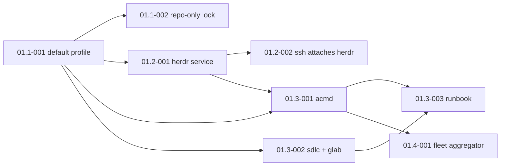

# USER STORIES - PROJECT OVERVIEW

> The epic files under `stories/` are the single source of truth for scope, acceptance criteria and progress. The sdlc controller builds from them (`sdlc build <story-id>`).

## User Personas

#### FX — solo developer / CTO-level operator
- **Role**: Runs agentic coding sessions (Claude Code, Codex) in herdr across an Omarchy XPS 13, a MacBook Pro M3 Max, home-lab and this Hetzner dev server, plus autonomous sdlc runs. The XPS runs the agentic-coding-monitor (acm) aggregator.
- **Goals**: Every machine shows up in acm; agents and sdlc runs can go to whichever machine has room; a server is rebuilt or joined from this repo, not by hand.
- **Pain Points**: Tools that exist only inside `nix develop`; packages and services installed on the box outside git; tmux and herdr nested.

#### The sdlc controller (machine persona)
- **Role**: Builds these stories autonomously.
- **Goals**: Stories verifiable offline in the local-ci-cd job container (shellcheck + bats).
- **Pain Points**: Anything that needs a live server, nix or the tailnet cannot run in CI; those checks stay static or run by FX.

## Epic Overview

| Epic ID | Epic Name | Business Value | Story Count | Total Points | Priority |
|---------|-----------|----------------|-------------|--------------|----------|
| Epic-01 | Agentic Fleet Host | The dev server joins the fleet from this repo only: toolset as the default profile, lock updates by MR, herdr instead of tmux, acmd and sdlc installed and pinned, fleet aggregator for the Android app | 8 | 27 | Must Have (FX, 2026-10-30) |

## Epic Navigation
- **[Epic-01: Agentic Fleet Host](./stories/epic-01-agentic-fleet-host.md)** — default Nix profile, repo-only `flake.lock`, herdr user service and ssh attach, acmd from the acm flake, sdlc + glab, onboarding runbook, fleet aggregator for acm's Android app.

## Dependencies

## Critical Path
1. 01.1-001 (everything depends on the default profile).
2. 01.2-001 (herdr pinned to the fleet's 0.9.3, FX 2026-10-30), then 01.2-002.
3. 01.1-002 and 01.3-002 in parallel with 01.2.
4. 01.3-001 after 01.2-001; 01.3-003 last.

## Totals
- **Total Stories**: 8
- **Total Story Points**: 27
- **Epics**: 1
